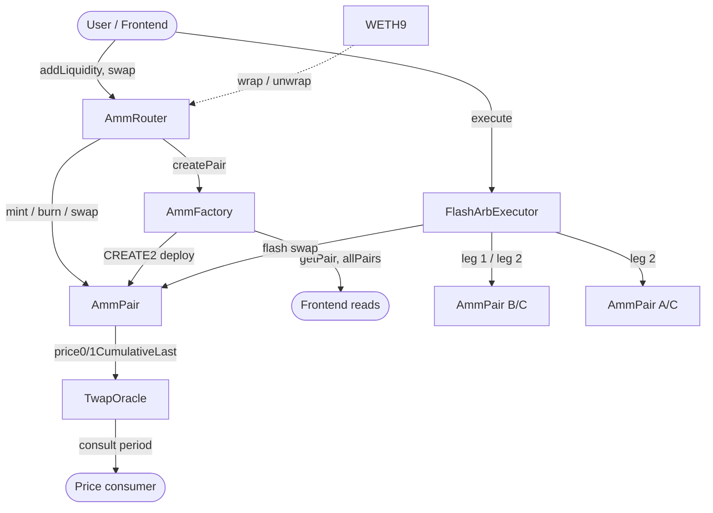

# amm-dex — Constant-Product AMM with TWAP Oracle and Flash-Swap Arbitrage

A production-shaped Uniswap-V2-style automated market maker written in Solidity 0.8.28, with
time-weighted average price (TWAP) infrastructure, capital-free triangular arbitrage, a full
Foundry test suite including stateful invariant fuzzing, and a React frontend that talks to a
locally deployed instance.

[](https://github.com/stayawaycc/amm-dex/actions/workflows/ci.yml)


---

## What this is

Three things, layered:

1. **A constant-product AMM core.** `AmmPair` holds two ERC-20 reserves and enforces
   `x * y >= k` on every swap, with a 0.30% fee that accrues to liquidity providers. Pairs are
   deployed deterministically by `AmmFactory` via CREATE2, so a pair address depends only on the
   two token addresses and never on call order.
2. **A price oracle that resists atomic manipulation.** `AmmPair` accumulates
   `sum(price_i * dt_i)` into `price0CumulativeLast` / `price1CumulativeLast`. `TwapOracle` turns
   those accumulators into an average over a chosen window. This is the difference between a
   price that a flash loan can move inside one transaction and a price that it cannot.
3. **A capital-free arbitrage executor.** `FlashArbExecutor` borrows one leg of a triangle with a
   flash swap, cycles it through the other two pools, repays the lender, and keeps the remainder.
   The arbitrageur needs no starting capital because the loan is repaid in the same transaction.

Everything is deployed and exercised locally with one command.

---

## Architecture



---

## Contract inventory

| Contract | Responsibility | Key invariant |
|---|---|---|
| `AmmFactory` | Deploys and indexes one pair per unordered token pair | At most one pair per `(token0, token1)`; pair address is a pure function of the sorted tokens |
| `AmmPair` | Holds reserves, mints/burns LP shares, executes swaps, accumulates TWAP prices | Fee-adjusted `k` never decreases; `MINIMUM_LIQUIDITY` permanently locked on first mint |
| `AmmRouter` | Stateless multi-hop swaps and liquidity provision, ETH wrapping | Router holds no token balance between transactions |
| `TwapOracle` | Converts cumulative prices into a windowed average | Returns an average over *actual* elapsed time, never a scaled-up spot price |
| `FlashArbExecutor` | Triangular arbitrage funded by a flash swap | Lender's invariant non-decreasing before profit is taken; callback only accepted from the active pair |
| `AmmLibrary` | Pure quoting maths and CREATE2 address derivation | `getAmountIn(getAmountOut(x))` is minimal; output always rounds down |

---

## Quick start

### Prerequisites

- [Foundry](https://book.getfoundry.sh/getting-started/installation) (`forge`, `cast`, `anvil`)
- Node.js 20+ and npm

### Contracts

```bash
git clone --recursive https://github.com/stayawaycc/amm-dex.git
cd amm-dex

forge build
forge test
```

`git clone --recursive` is required: `lib/forge-std` and `lib/openzeppelin-contracts` are git
submodules.

### Full local stack (contracts + frontend)

```bash
npm install
npm run dev:all
```

`dev:all` starts Anvil, deploys the contracts, seeds two pools with demo liquidity, writes the
addresses to `deployments/31337.json`, and starts the Vite dev server. Open the printed URL.

### Manual path (if you prefer to see each step)

```bash
# Terminal 1
anvil

# Terminal 2
forge script script/Deploy.s.sol --rpc-url http://127.0.0.1:8545 --broadcast
forge script script/SeedLiquidity.s.sol --rpc-url http://127.0.0.1:8545 --broadcast

# Terminal 3
npm run dev
```

> **Windows note.** If a system HTTP proxy is configured, set `NO_PROXY=127.0.0.1,localhost`
> before running any `forge`/`cast` command. Otherwise the proxy intercepts the local RPC call and
> returns 502.

---

## Test suite

```
forge test
```

| Suite | Tests | What it covers |
|---|---|---|
| `AmmPair.t.sol` | 28 | Initialization, mint/burn accounting, swap curve, fee accrual, `sync`/`skim`, TWAP accumulation, protocol fee |
| `AmmRouter.t.sol` | 21 | Liquidity provision with optimal ratio, slippage guards, multi-hop swaps, exact-output swaps, all four ETH paths |
| `TwapOracle.t.sol` | 16 | Window validation, price correctness, atomic-manipulation resistance, sustained-manipulation limits, staleness |
| `FlashArb.t.sol` | 16 | Authorization guards, triangle validation, profitable execution, lender repayment, residual balance |
| `Invariant.t.sol` | 5 | Solvency, LP supply integrity, non-zero reserves, cumulative price monotonicity, `k` bounds |
| **Total** | **86** | **86 passing, 0 failing** |

### Coverage

`forge coverage --report summary --ir-minimum`

| Contract | Lines | Statements | Branches | Functions |
|---|---|---|---|---|
| `AmmPair.sol` | 98.11% | 98.50% | 71.05% | 100.00% |
| `TwapOracle.sol` | 100.00% | 100.00% | 71.43% | 100.00% |
| `FlashArbExecutor.sol` | 100.00% | 96.55% | 61.54% | 100.00% |
| `AmmLibrary.sol` | 100.00% | 100.00% | 25.00% | 100.00% |
| `AmmRouter.sol` | 83.78% | 84.96% | 22.64% | 85.00% |
| `AmmFactory.sol` | 75.00% | 80.00% | 0.00% | 66.67% |
| **Core contracts total** | **93.9%** | **94.2%** | **62.5%** | **92.9%** |
| Whole repo (incl. scripts, mocks, tests) | 83.10% | 84.42% | 40.65% | 86.81% |

The uncovered branches are concentrated in `require`-guard false paths that are unreachable by
construction (e.g. `create2` returning zero) and in the deploy scripts, which are exercised
end-to-end by the CI `deploy-smoke` job rather than by unit tests.

### Fuzzing


- Property fuzz tests run **512 cases** each by default.
- Stateful invariant tests run **128 runs × 32 depth** (4096 calls per invariant) with a handler
  that performs `addLiquidity`, `removeLiquidity`, `swap0For1`, `swap1For0`, `donate`, `skim`,
  `sync` and `warp`.
- CI runs the `ci` profile: **2048 fuzz cases** and **256 × 64 invariant depth**.

Notable properties proven:

| Property | Test |
|---|---|
| Output is always strictly less than input (no free lunch) | `testFuzz_SwapNeverProfitable` |
| A round trip through one pool always loses value to fees | `testFuzz_RoundTripAlwaysLosesToFee` |
| `getAmountIn` returns the *minimal* input that still delivers the output | `testFuzz_AmountInIsMinimal` |
| The pair is always solvent against all LPs simultaneously | `invariant_PairIsSolvent` |
| LP supply always equals the sum of all holder balances | `invariant_LpSupplyMatchesBalances` |
| A single-transaction price manipulation does not move the TWAP | `test_Manipulation_SpotPriceMovesButTwapDoesNot` |
| The arb executor always repays the lender, for any borrow size | `testFuzz_LenderAlwaysRepaid` |

---

## Security design

### Reentrancy

`AmmPair` uses a storage `unlocked` flag rather than a library, so the guard costs one SSTORE per
call instead of an extra external call. `AmmRouter` and `FlashArbExecutor` use OpenZeppelin's
`ReentrancyGuard`. Flash swaps are deliberately *not* blocked: the callback is the mechanism, and
the invariant check after the callback is what makes it safe.

### The `k` check

Swaps verify

```
(balance0 * 1000 - amountIn0 * 3) * (balance1 * 1000 - amountIn1 * 3)
    >= reserve0 * reserve1 * 1000^2
```

This is equivalent to applying the 0.30% fee before checking `x * y`, and it is what allows a
caller to take tokens out *before* paying them back. Any flash-swap borrower that fails to repay
enough simply reverts, so the pool can never be drained.

### TWAP manipulation resistance

A spot price read from `getReserves()` can be moved arbitrarily inside one transaction with a
flash loan. The cumulative accumulators cannot: they only advance when the pair is touched, and
they advance by `price * dt`. A manipulation that lasts zero seconds therefore contributes zero
to the accumulator.

The test `test_Manipulation_SpotPriceMovesButTwapDoesNot` demonstrates this concretely: an attacker
dumps 5,000,000 tokens into a 10,000/10,000 pool, crushing the spot price by more than 50%, while
the TWAP over the same window stays within 5% of its original value.

The limit is stated honestly rather than hidden: `test_Manipulation_SustainedPriceMovesTwap` shows
that an attacker willing to hold the bad price for the *entire* window does move the average. This
is why `MIN_PERIOD` is a floor, not an endorsement, and why integrators should choose a window
longer than the cost of sustaining a manipulation.

### Rounding direction

Every rounding decision is made in the pool's favour:

| Operation | Direction | Consequence |
|---|---|---|
| `getAmountOut` | down | The trader can never receive more than the curve allows |
| `getAmountIn` | up (+1 wei) | The trader can never underpay for a requested output |
| `mint` liquidity | down | No LP can mint shares for free |
| `burn` amounts | down | The pool never pays out more than its share |

### Minimum liquidity

The first mint permanently locks `1e3` LP shares to `address(0xdead)`. This keeps `totalSupply`
strictly positive forever, which closes the donation-based share-price inflation vector on a
brand-new pool.

### Protocol fee

`AmmFactory.feeTo` is disabled by default (`address(0)`). When enabled, `_mintFee` mints `1/6` of
the growth in `sqrt(k)` to the fee recipient, which is the standard Uniswap-V2 split.

---

## Gas

Measured with `forge test --gas-report` on solc 0.8.28, optimizer on, 200 runs, `via_ir = true`.

| Operation | Gas |
|---|---|
| `AmmPair.mint` (first liquidity) | ~220,000 |
| `AmmPair.mint` (subsequent) | ~208,000 |
| `AmmPair.burn` | ~216,000 |
| `AmmPair.swap` | ~211,000 |
| `AmmRouter.addLiquidity` | ~2,000,000 (includes pair creation) |
| `AmmRouter.swapExactTokensForTokens` (single hop) | ~2,030,000 |
| `AmmRouter.swapExactTokensForTokens` (two hops) | ~3,990,000 |
| `FlashArbExecutor.execute` | ~346,000 |

The router numbers include the `CREATE2` deployment of the pair on first use, which dominates.
Warm-path swaps are the `AmmPair.swap` figure plus router overhead.

---

## Repository layout

```
amm-dex/
├── src/
│   ├── AmmFactory.sol          # CREATE2 pair registry
│   ├── AmmPair.sol             # constant-product pool + TWAP accumulators
│   ├── AmmRouter.sol           # stateless entry point
│   ├── TwapOracle.sol          # windowed average price
│   ├── FlashArbExecutor.sol    # triangular arbitrage
│   ├── interfaces/             # IAmmPair, IAmmFactory, IAmmCallee, IWETH
│   ├── libraries/              # AmmLibrary, Math, UQ112x112
│   └── mocks/                  # MockERC20, WETH9
├── test/
│   ├── BaseTest.sol            # shared fixture
│   ├── AmmPair.t.sol
│   ├── AmmRouter.t.sol
│   ├── TwapOracle.t.sol
│   ├── FlashArb.t.sol
│   └── Invariant.t.sol         # handler-based stateful fuzzing
├── script/
│   ├── Deploy.s.sol            # full stack deployment + JSON output
│   └── SeedLiquidity.s.sol     # demo liquidity
├── frontend/                   # Vite + React + wagmi
├── deployments/                # generated per-chain address JSON
├── foundry.toml
└── package.json                # dev:all orchestration
```

---

## Design decisions worth defending

**Why not Uniswap V3 concentrated liquidity?** V3's tick maths is a different project. This
codebase deliberately targets the V2 curve, where the invariants are provable in a few lines and
the fuzzing surface is tractable. The interesting engineering here is the oracle and the arb
executor, not tick bitmap arithmetic.

**Why a separate `TwapOracle` contract instead of reading accumulators directly?** Consumers would
otherwise each reimplement the window arithmetic and get the division wrong. `consult` divides by
*actual elapsed time*, not by the requested period, so a consumer cannot accidentally receive a
value that is silently scaled up when the accumulator is older than expected.

**Why triangular arbitrage rather than two-pool?** A factory keys pools by the unordered token
pair, so `A/B` can only ever have one pool. Two-pool arbitrage requires a second venue; a triangle
is the structure that actually exists inside one factory, and it is what the executor is built for.

**Why `via_ir = true`?** The router's ETH paths exceed the legacy pipeline's stack depth. `via_ir`
resolves it at the cost of slower compiles (~10s for a clean build, which is acceptable).

---

## License

MIT. See [LICENSE](LICENSE).
